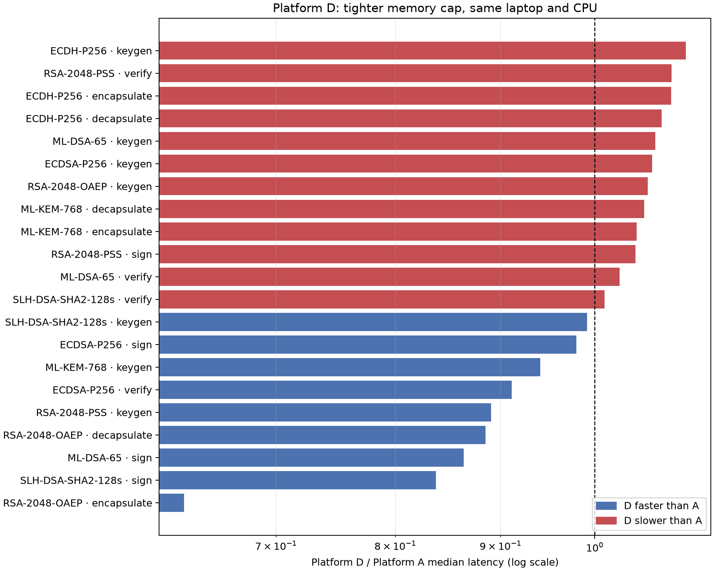

# Optional Platform D — tighter-memory emulation

## Profile and reason

Platform D tests whether the same benchmark workload completes with less process memory headroom than Platform B. It uses the same Windows laptop, Python environment, crypto libraries, one pinned CPU core, and single-thread settings, but lowers the process-tree RSS cap from B's 128 MB to **96 MB**. This is a custom gateway-like memory-budget profile. It is not a physical constrained device and does not model a slower CPU, different architecture, power use, or flash storage.

The repeated workload follows the project's standard correctness-before-timing protocol: all seven CORE algorithms, 10 warm-ups per operation, the same sample counts and message, and **3 saved repetitions**. Reproduce it from the project root with:

```powershell
./.venv/Scripts/python.exe P3_benchmark/run_repeats.py --platform D --repeats 3
./.venv/Scripts/python.exe P3_benchmark/analyze_platform_D.py
```

The D profile is declared in `common/run_on_platform.py`. Platform D is optional; A/B official profiles and their comparisons are unchanged.

## Outcome

The standalone correctness run passed **610/610 trials** across the seven algorithms. Benchmark-internal correctness checks also passed **1830/1830 trials** across the three repetitions. All three benchmark runs completed with `status=ok`. Peak process-tree RSS was **83.4–83.6 MB** against the 96 MB cap, leaving about **12.4 MB** at the highest observed peak. Correctness runner peak was 40.6 MB.

Across the 21 operation medians, **21/21 D/B ratios** were within a factor of 1.4. The profile keeps the same one-core execution and changes the memory ceiling; because observed use stayed below the cap, it did not force an out-of-memory condition. Its main result is that this workload completed under a 96 MB process-tree limit on this host. The timing differences should not be attributed to a slower device or a physical memory-constrained system.



## Run records

| Run | Status | Peak RSS (MB) | Budget (MB) | Wall time (s) |
|---|---|---:|---:|---:|
| Correctness | ok | 40.6 | 96 | 33.868 |
| Benchmark 1 | ok | 83.6 | 96 | 218.04 |
| Benchmark 2 | ok | 83.5 | 96 | 214.078 |
| Benchmark 3 | ok | 83.4 | 96 | 213.665 |

## Operation medians

All values are milliseconds; ratios above 1 mean D was slower than the comparison platform. D medians are the median of the three saved run medians; A/B use the project's existing three-run summaries.

| Algorithm | Operation | A median | B median | D median | D/A | D/B |
|---|---|---:|---:|---:|---:|---:|
| ECDH-P256 | decapsulate | 0.0565 | 0.0584 | 0.0609 | 1.078 | 1.043 |
| ECDH-P256 | encapsulate | 0.0909 | 0.0959 | 0.0990 | 1.089 | 1.032 |
| ECDH-P256 | keygen | 0.0242 | 0.0268 | 0.0268 | 1.107 | 1.000 |
| ECDSA-P256 | keygen | 0.0241 | 0.0251 | 0.0257 | 1.066 | 1.024 |
| ECDSA-P256 | sign | 0.0441 | 0.0430 | 0.0432 | 0.980 | 1.005 |
| ECDSA-P256 | verify | 0.0993 | 0.0922 | 0.0905 | 0.911 | 0.982 |
| ML-DSA-65 | keygen | 0.2746 | 0.2856 | 0.2938 | 1.070 | 1.029 |
| ML-DSA-65 | sign | 1.2329 | 1.2612 | 1.0649 | 0.864 | 0.844 |
| ML-DSA-65 | verify | 0.2753 | 0.2765 | 0.2831 | 1.028 | 1.024 |
| ML-KEM-768 | decapsulate | 0.0917 | 0.1186 | 0.0969 | 1.057 | 0.817 |
| ML-KEM-768 | encapsulate | 0.0605 | 0.0613 | 0.0634 | 1.048 | 1.034 |
| ML-KEM-768 | keygen | 0.2558 | 0.2737 | 0.2407 | 0.941 | 0.879 |
| RSA-2048-OAEP | decapsulate | 0.7557 | 0.6473 | 0.6687 | 0.885 | 1.033 |
| RSA-2048-OAEP | encapsulate | 0.0532 | 0.0317 | 0.0336 | 0.632 | 1.060 |
| RSA-2048-OAEP | keygen | 51.0411 | 52.9273 | 54.1482 | 1.061 | 1.023 |
| RSA-2048-PSS | keygen | 55.9641 | 53.1974 | 49.8226 | 0.890 | 0.937 |
| RSA-2048-PSS | sign | 0.6438 | 0.7035 | 0.6738 | 1.047 | 0.958 |
| RSA-2048-PSS | verify | 0.0357 | 0.0410 | 0.0389 | 1.090 | 0.949 |
| SLH-DSA-SHA2-128s | keygen | 225.2755 | 225.8861 | 223.3234 | 0.991 | 0.989 |
| SLH-DSA-SHA2-128s | sign | 2039.4524 | 1744.8764 | 1707.3320 | 0.837 | 0.978 |
| SLH-DSA-SHA2-128s | verify | 1.6918 | 1.7854 | 1.7107 | 1.011 | 0.958 |

Raw D data: `results/bench_platform_D.csv` (latest run) and `results/repeats/bench_platform_D_run_01.csv` through `_03.csv`. The operation comparison chart is `results/charts/platform_D_vs_A_B.png`.
